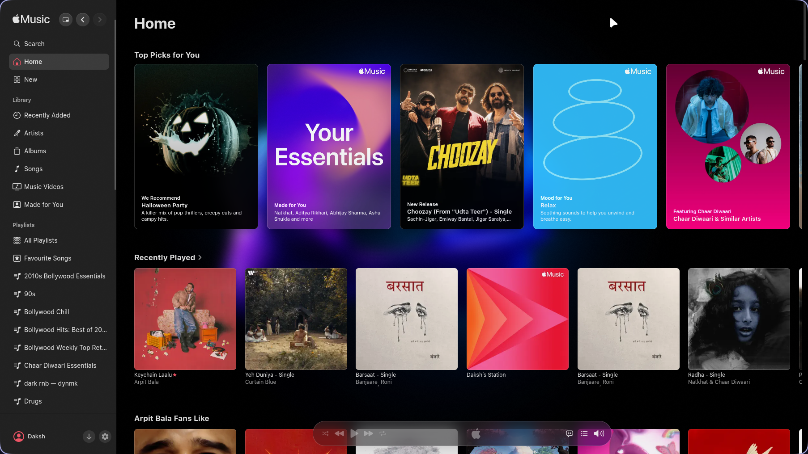
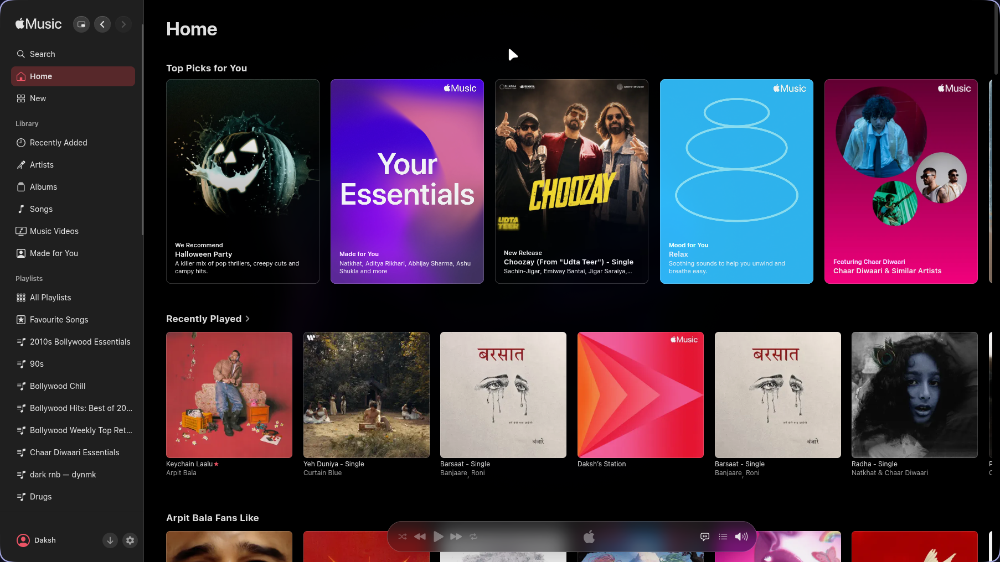
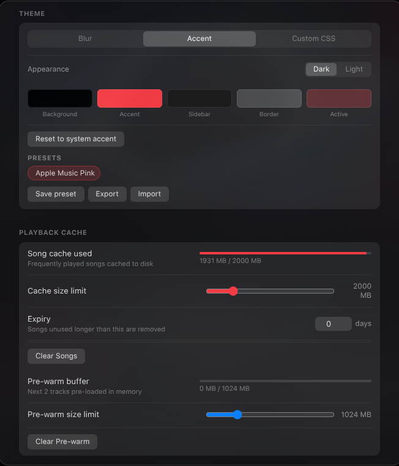
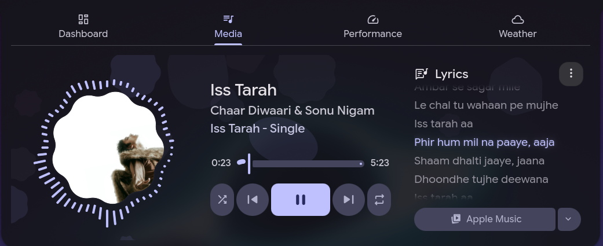
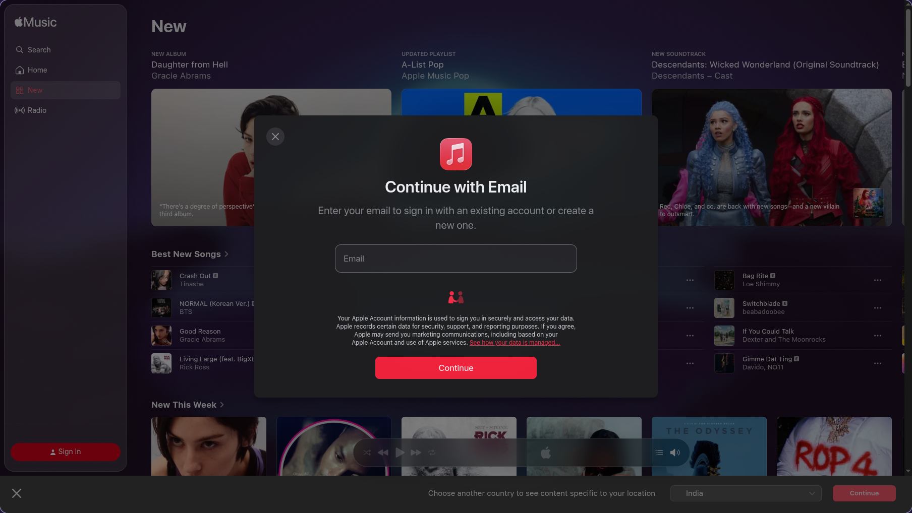
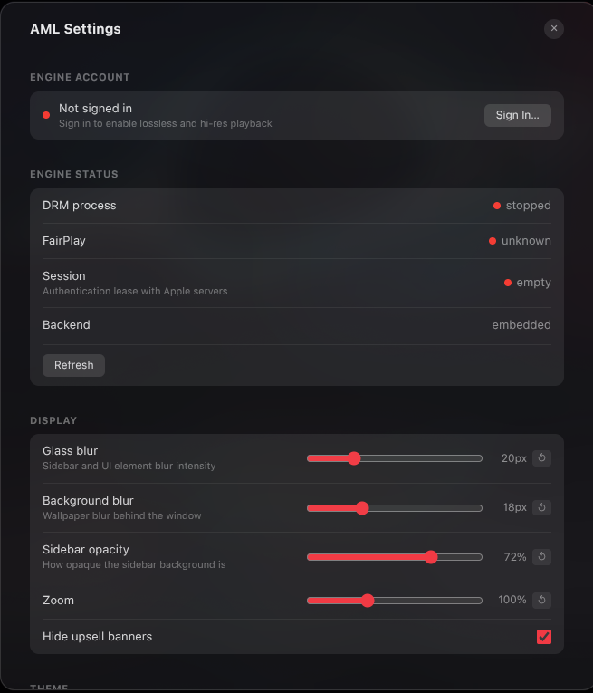
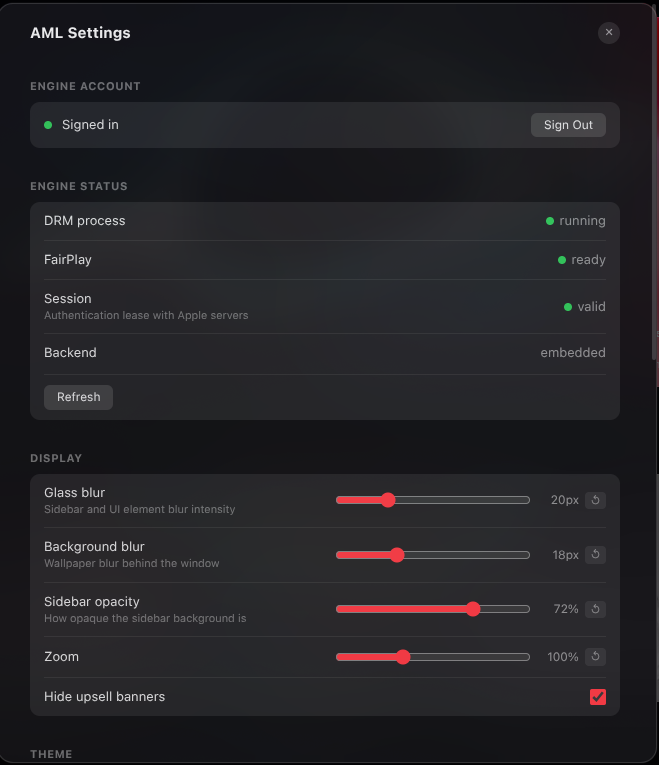

<div align="center">

# Kapple Music

[](https://github.com/Kapy2003/Kapple_Music/releases/latest)
[](LICENSE)
[](https://github.com/Kapy2003/Kapple_Music/releases/latest)

An Apple Music desktop client for Linux — lossless audio (ALAC up to 192kHz), music videos, downloads, and a native-feeling visionOS glass UI.

<div align="center">
  
  
</div>

</div>

> [!IMPORTANT]
> **Disclaimer**
>
> **No Affiliation**
>
> This project and its contributors are not affiliated with, authorized by, endorsed by, or in any way officially connected with Apple Inc. or any of its subsidiaries or affiliates. This is an independent, unofficial client developed for personal use.
>
> **Trademarks**
>
> "Apple Music", "Apple", and related names, marks, and logos are registered trademarks of Apple Inc. Any use of these trademarks is for identification and reference purposes only and does not imply any association with the trademark holder.
>
> **Limitation of Liability**
>
> This application is provided "AS IS". The developers are not liable for any claim, damages, or legal consequences arising from its use. You use it entirely at your own risk. An active Apple Music subscription is required.

## Contents

[Features](#features) · [Roadmap](#roadmap) · [Requirements](#requirements) · [Download & Install](#download--install) · [Opening links](#opening-links-in-kapple-music) · [Login](#login) · [Dev](#dev) · [Build](#build) · [Project structure](#project-structure) · [Changelog](#changelog) · [Community](#community) · [References](#references)

## Features

### Playback
- **Lossless & Hi-Res** — ALAC up to 192kHz via FairPlay-decrypted HLS
- **AAC streaming** — dedicated MSE pipeline for AAC with accurate seek
- **In-process DRM** — FairPlay runs inside the engine, with no helper process or local sockets
- **Clean mode switching** — moving between lossless, AAC and music video stops the previous player first, so tracks never overlap
- **Music Videos** — full MV playback with resolution selector (480p → 1080p), subtitles, fullscreen, and fast fragment-level seeking; H.264-preferred to avoid HEVC decode issues on Linux
- **Audio quality badge** — shows codec, bit depth, and sample rate right in the player bar; click for full stream details

### Downloads
- Save individual tracks, full albums, or entire playlists to disk in one click
- Music videos download as a properly muxed file (audio + video combined)
- Live byte-by-byte progress during download
- Configurable filename templates: `{artist}`, `{album}`, `{quality}`, `{isrc}`, `{release_date}`, and more
- Cover art embedded in every file, including FLAC
- Output folder configurable via a native folder picker

### Themes & Appearance
- **Three theme modes**: Blur (your wallpaper, blurred, behind the app), Accent (the fixed Apple Music palette, with per-colour pickers and your own saved presets), or a fully custom CSS file. Signed-out pages always use Blur
- **Album art theming** — album and playlist pages take their colours from the artwork, and follow the playing track
- Save and share your own theme presets (export/import JSON)
- Adjustable blur strength and sidebar opacity sliders
- Collapsible sidebar with centered main content and smooth transition
- Light and dark mode support

<div align="center">
  
</div>

<details open>
<summary><b>Compositor &amp; blur details</b></summary>

- Native `blur-behind` on KDE X11 (KWin) and KDE Wayland — no screen-share dialog
- Hyprland wallpaper blur via `hyprpaper` / `swww`
- Wallpaper blur on GNOME (read from desktop settings), with glass effect across Linux desktops
- Software blur fallback on X11 and Sway
- Automatically switches to software blur if the GPU crashes

</details>

### System Integration
- **MPRIS2** — play/pause, next/prev, seek, shuffle, and volume via D-Bus (works with KDE, GNOME shell, Waybar, etc.)

<div align="center">
  
</div>

- **Media keys** — hardware play/pause, next, and previous keys work even when the window is in the background (includes Bluetooth AVRCP)
- **System tray** — minimize to tray; playback controls in the right-click menu
- **Mini player** — compact always-on-top now-playing window with track progress, volume control, favorite toggle, and quality badge
- **Discord Rich Presence**, **Last.fm** and **ListenBrainz** scrobbling
- **Wayland + X11** — tested on Hyprland, KDE Plasma, GNOME, and Sway

<details open>
<summary><b>Other</b></summary>

- **Play History** — last 30 songs in the native Up Next panel; click any to replay; persists across restarts
- Back / Forward navigation buttons in the sidebar header
- Smart segment cache — tracks pre-warmed before you press play
- Separate cache for music video segments (2 GiB by default, adjustable)
- Encrypted local library cache that persists across restarts
- Settings auto-save with visual confirmation

</details>

## Roadmap

- **arm64 support** — packaging and wrapper binary for Apple Silicon / Raspberry Pi

## Requirements

- Linux x86_64 with glibc ≥ 2.35 (Ubuntu 22.04+, Fedora 36+, Debian 12+, Arch), PulseAudio or PipeWire
- Active Apple Music subscription

VLC (audio subset) and a minimal FFmpeg are bundled in every Linux package — no system VLC or FFmpeg needed.

A Wayland compositor with blur support (Hyprland, KWin) gives the best glass UI. X11, GNOME, and Sway use a software blur fallback.

## Download & Install

Two formats are available (both contain the same build):

| | Format | Size | Best for |
|:-:|---|--:|---|
| **A** | [`.run` installer](#option-a--run-installer-96-mb-recommended) | 96 MB | Most Linux users — no root needed (**recommended**) |
| **B** | [AppImage](#option-b--appimage-140-mb-portable) | 140 MB | Portable, nothing installed |

### Option A — `.run` installer (96 MB, recommended)

No dependencies, no root required for a user install.

```bash
chmod +x kapple-music.run
./kapple-music.run
```

This installs to `~/.local/lib/kapple-music` and adds a launcher to `~/.local/bin`. A desktop entry and icon are registered automatically.

**Other install options:**

```bash
./kapple-music.run --system       # install system-wide to /opt/ (needs sudo)
./kapple-music.run --force        # overwrite an existing installation
./kapple-music.run --no-lossless  # skip the FairPlay library download (lossless stays off)
./kapple-music.run --uninstall    # remove the installation
./kapple-music.run --help         # show all options
```

After install, launch from your app menu or run `kapple-music` in a terminal.

### Lossless (ALAC) and the FairPlay libraries

Lossless and hi-res playback decrypt through Apple's own Android FairPlay libraries, which Kapple Music
is not allowed to redistribute. They are downloaded on your machine instead (about 65 MB, pinned and checksum-verified), so Kapple Music itself stays
open source. The `.run` installer fetches them at the end of the install; the other formats fetch them on first launch.

> [!NOTE]
> Without them everything else works and playback uses AAC 256 kbps.

<details open>
<summary>Where they come from and how to repair them</summary>

- The `.run` installer downloads them at the end of a user install (~65 MB).
- The AppImage and a `--system` install download them in the background on first launch;
  lossless switches on by itself once they are in place (at the next pause if something is playing).
- They come from the [wrapper project](https://github.com/WorldObservationLog/wrapper), with
  [a fork](https://github.com/Kapy2003/wrapper) as fallback, pinned to fixed commits. Every file
  is checked against the SHA-256 list in `drm/fairplay-libs.lock`; a file that does not match is refused.
- They go to `~/.config/kapple-music/drm/rootfs/system/lib64`. To retry or repair, run the bundled
  script: `sh ~/.local/lib/kapple-music/resources/fetch-fairplay-libs.sh` (adjust the path for `--system`
  installs or an extracted AppImage), or in a source checkout: `sh scripts/fetch-fairplay-libs.sh`.

</details>

### Option B — AppImage (140 MB, portable)

No install needed — just run it directly.

```bash
chmod +x Kapple-Music-*-x86_64.AppImage
./Kapple-Music-*-x86_64.AppImage
```

[AppImageLauncher](https://github.com/TheAssassin/AppImageLauncher) can integrate it into your app menu automatically on first run.

Release builds are made on Ubuntu 22.04 (glibc 2.35, checked in CI by `scripts/check-glibc.sh`) and packed with the static AppImage runtime, so they start on 22.04 and newer without `libfuse2`. If your system still has trouble mounting AppImages, run it without FUSE: `./Kapple-Music-*-x86_64.AppImage --appimage-extract-and-run`.

### GNOME

The system tray requires the [AppIndicator extension](https://extensions.gnome.org/extension/615/appindicator-support/). The glass UI uses a software blur fallback on GNOME — Mutter does not support compositor blur-behind.

## Opening links in Kapple Music

Kapple Music opens Apple Music links from other apps and from the command line (`kapple-music <link>`):

- **`kapple-music://`** links always work: `kapple-music://song/<id>`, `kapple-music://album/<id>`, `kapple-music://playlist/<id>`, `kapple-music://play/<s|a|p|r>/<id>`, `kapple-music://open/<s|a|p|r>/<id>` (add `?sf=us` for a storefront), or `kapple-music://music.apple.com/...` with any Apple Music path.
- **Apple Music URLs** (`https://music.apple.com/...` on any Apple Music host, including legacy `itunes.apple.com` links and `?i=` song links) play when they point at a song, album, playlist, artist or music video, and open in the app for any other page (browse, radio, search, curators, library, stations).
- **Apple's own schemes** are the ones the Apple Music app registers (full list below). **Kapple Music claims none of them until you turn them on in Settings → Links**, one by one, because claiming a scheme takes it away from whatever handles it now. `daap://` (shared iTunes libraries) and `itpc://` (podcast subscriptions) cannot be played in a web client, so Kapple Music shows a notice for them.

<details open>
<summary>Apple Music URI schemes Settings → Links can claim</summary>

`music://` `musics://` `itms://` `itmss://` `itunes://` `itals://` `italss://` `itvls://` `itvlss://` `itsradio://` `itunesradio://` `daap://` `itpc://`

</details>

A plain `https://music.apple.com` link clicked in another app opens in your browser: operating systems do not let an app claim links for another company's website. To get from the browser into Kapple Music, turn on `music://` and click **Open in Music** on the website, or use a URL-redirect browser extension that rewrites `music.apple.com` to `kapple-music://music.apple.com`.

## Login

Two sign-ins are needed on Linux.

### 1. Apple Music web session

Sign in on first launch the same way you would at music.apple.com. This covers AAC playback, the catalog, and your library.

<div align="center">
  
</div>

### 2. Lossless account activation (lossless, hi-res)

This authenticates the FairPlay DRM layer. Without it, playback seamlessly uses AAC 256 kbps.

<div align="center">
  
  
</div>

1. Click the **Settings** cog wheel in the top-right corner.
2. In the **Apple Account** section, click **Enable Lossless…**.
3. Sign in with your **Apple ID email address** (e.g. `user@gmail.com` or `user@icloud.com`) or your phone number with country code (e.g. `+911234567890`).
   > [!TIP]
   > Phone numbers must include the international country code (e.g. `+91` for India). If you are unsure, use the primary email address linked to your Apple Account.
4. Enter your password, check **Remember password on this computer**, and click **Sign In**.
5. Enter the six-digit verification code (2FA) displayed on your Apple devices when prompted.

Under **Engine Status** in Settings, FairPlay will show **ready** (green) and Session will show **valid** (green).

## Dev

The bundled FFmpeg (`third_party/ffmpeg`) is stored with [Git LFS](https://git-lfs.com), so install it before cloning.

```bash
git lfs install
git clone https://github.com/Kapy2003/Kapple_Music
cd Kapple_Music
```

### Quick start (Makefile)

```bash
make fairplay    # Download & verify Apple FairPlay libraries (for ALAC lossless)
make dev         # Install dependencies, build bundles & engine, and launch the app
```

### Manual development setup

**Dependencies:**

```bash
# Arch
sudo pacman -S vlc nodejs npm

# Ubuntu/Debian
sudo apt install vlc nodejs npm build-essential
```

**Fetch Apple's FairPlay libraries:**

```bash
make -C drm android-stubs
sh scripts/fetch-fairplay-libs.sh
```

**Launch local development instance:**

```bash
cd electron
bash build.sh
```

`build.sh` automatically installs npm dependencies if missing, bundles renderer scripts via esbuild, builds the Go engine and C DRM client, bundles VLC libs into `dist/resources/vlc`, and launches Electron.

**Rebuilding individual components:**

```bash
# Renderer bundles (engine-playback, smart-cache, engine-sse, vision-glass)
node electron/build-renderer.mjs

# Go playback engine
bash scripts/build-engine.sh electron/dist/resources -ldflags="-w -s" -trimpath

# Run test suites
node --test electron/test/*.test.mjs
```

## Build

### Quick build

```bash
make build                  # Builds DRM library, Go engine, and AppImage → electron/dist/*.AppImage
scripts/build-installer.sh  # Self-extracting .run installer → dist/kapple-music.run
```

### Cleaning

```bash
make clean                  # Remove compiler objects and intermediate staging files
scripts/clean.sh --dist     # Also remove packaged output (dist/, AppImage, linux-unpacked)
scripts/clean.sh --all      # Also remove built libdrm_client.so and electron/dist
scripts/clean.sh --dry-run  # Preview files that would be removed without deleting
```

Your Apple session credentials (`drm/files`) are never touched by clean scripts.

## Project structure

<details open>
<summary>Directory tree</summary>

```
Kapple_Music/
├── electron/                  Desktop shell
│   ├── main.mjs               Main process: window, IPC, MPRIS2, tray, themes, prefs,
│   │                          Discord / Last.fm / ListenBrainz, engine lifecycle
│   ├── preload.cjs            kappleBridge: IPC surface exposed to music.apple.com
│   ├── auth-preload.cjs       Preload script for Apple ID login modal sheet
│   ├── miniplayer.html        Mini player window (with miniplayer-preload.cjs)
│   ├── offline.html           Offline fallback page
│   ├── build-renderer.mjs     Bundles renderer scripts with esbuild
│   ├── build.sh               Dev startup script
│   ├── src/                   Renderer code injected into the Apple Music web player
│   │   ├── engine-playback.js Playback, queue, settings panel, theming, MSE and MV pipelines
│   │   ├── engine/            ES modules bundled into engine-playback.js
│   │   │                      (handoff rules, catalog helpers, album palette, MP4 parser)
│   │   ├── engine-sse.js      Server-sent-events client for engine state
│   │   ├── smart-cache.js     Reports what you are looking at so the engine can pre-warm it
│   │   └── vision-glass.js    Glass UI and CSS overrides
│   ├── *-bundle.js            Generated by build-renderer.mjs (do not edit)
│   └── test/                  node --test suites for renderer and main process
├── engine/                    Go HTTP engine (127.0.0.1:20025, TLS)
│   ├── cmd/                   Server, routes and handlers (playback, VLC, cache, export, library)
│   ├── core/
│   │   ├── apple/             Apple Music provider (catalog → HLS → sessions)
│   │   ├── playback/          Session lifecycle and stream coordination
│   │   ├── pipeline/          Source / stage types for the media pipeline
│   │   ├── fairplay/          CBCS ALAC decryption and license pool
│   │   ├── drm/               DRM manager and in-process native backend (cgo)
│   │   ├── hls/               Playlist parsing
│   │   ├── vlc/               In-process libvlc for lossless playback
│   │   ├── diskcache/         Disk cache with LRU eviction
│   │   ├── prefetch/          Background pre-warm scheduler
│   │   ├── export/            Track and music-video export
│   │   ├── library/           Encrypted local library cache
│   │   └── archtest/          Import-boundary tests
│   ├── internal/              Internal engine helpers
│   └── utils/                 aacstream, alacstream, ampapi, lyrics, mvlabel, config
├── drm/                       DRM library (libdrm_client.so)
│   ├── drm_linux.c            Session lifecycle and account files
│   ├── drm_hybris.c           Loads Apple's Android FairPlay libraries through libhybris
│   ├── embedded_loader.c      In-memory ELF / SO loader for Android stubs
│   ├── native/                Vendored wrapper: FairPlay login, lease, key contexts, decrypt
│   ├── stubs/                 Stand-ins for Android libraries Apple's code links but never calls
│   ├── fairplay-libs.lock     Pinned sources + SHA-256 of Apple's libraries (fetched, never shipped)
│   └── files/                 Your Apple session (never packaged or committed)
├── third_party/               Prebuilt minimal FFmpeg (LGPL, Git LFS): ffmpeg/ for Linux
├── scripts/                   build-installer.sh, build-engine.sh, build-renderer.sh,
│                              bundle-vlc.sh, build-ffmpeg.sh, build-vlc-ffmpeg.sh, clean.sh,
│                              check-glibc.sh, repack-appimage.sh, fetch-fairplay-libs.sh, lint.sh
├── verification/              API schema, QA console, benchmark and test harnesses
├── assets/                    Screenshots and tray icon
├── kapple-music-custom.example.css     Template for the Custom CSS theme
├── CHANGELOG.md
├── Makefile                   Root Makefile: make fairplay, make dev, make build, make clean
└── LICENSE
```

</details>

How the pieces fit: the Electron app loads music.apple.com and injects the renderer bundles. The renderer asks the engine for a session per track. The engine fetches the stream and either serves AAC to a MediaSource in the page, or decrypts the lossless stream fragment by fragment through Apple's FairPlay code (loaded by the DRM library) and plays it through libvlc inside the engine.

## Changelog

See [CHANGELOG.md](CHANGELOG.md) for what changed in each release.

## Community

Questions, bug reports, feature requests and polls live on the [Kapple Music Discord server](https://discord.gg/Chilling_Room/Tvf8UmyMJF).

## References

<details open>
<summary>libraries and projects Kapple Music builds on</summary>

**Runtime**
- [Electron](https://electronjs.org) — desktop shell
- [libvlc](https://www.videolan.org/vlc/libvlc.html) — lossless audio playback, bundled as an audio-only subset
- [FFmpeg](https://ffmpeg.org) — a minimal LGPL build (9.0.2, [source](https://ffmpeg.org/releases/ffmpeg-9.0.2.tar.xz)) is bundled for music-video remuxing and export, and supplies the codec libraries VLC loads
- [OpenSSL](https://www.openssl.org) and [libcurl](https://curl.se) — AES decryption and HTTP in the DRM client library
- [MusicKit JS](https://developer.apple.com/documentation/musickitjs) — Apple's web playback SDK, loaded from music.apple.com

**Go engine**
- [musickit-sdk-linux](https://github.com/Kapy2003/musickit-sdk-linux) — the engine as a standalone SDK: a local HTTP API for Apple Music playback, FairPlay DRM, lossless audio, lyrics and downloads
- [mp4ff](https://github.com/Eyevinn/mp4ff) (via the itouakirai fork) and [go-mp4tag](https://github.com/zhaarey/go-mp4tag) — MP4 parsing and tagging
- [grafov/m3u8](https://github.com/grafov/m3u8) — HLS playlists
- [modernc.org/sqlite](https://pkg.go.dev/modernc.org/sqlite) — the encrypted library cache

**Electron app**
- [mpris-service](https://github.com/dbkr/mpris-service) — MPRIS2 over D-Bus
- [esbuild](https://esbuild.github.io) — renderer bundles
- [electron-builder](https://www.electron.build) — AppImage and package layout
- [Last.fm](https://www.last.fm/api) and [ListenBrainz](https://listenbrainz.readthedocs.io) — scrobbling APIs

</details>
